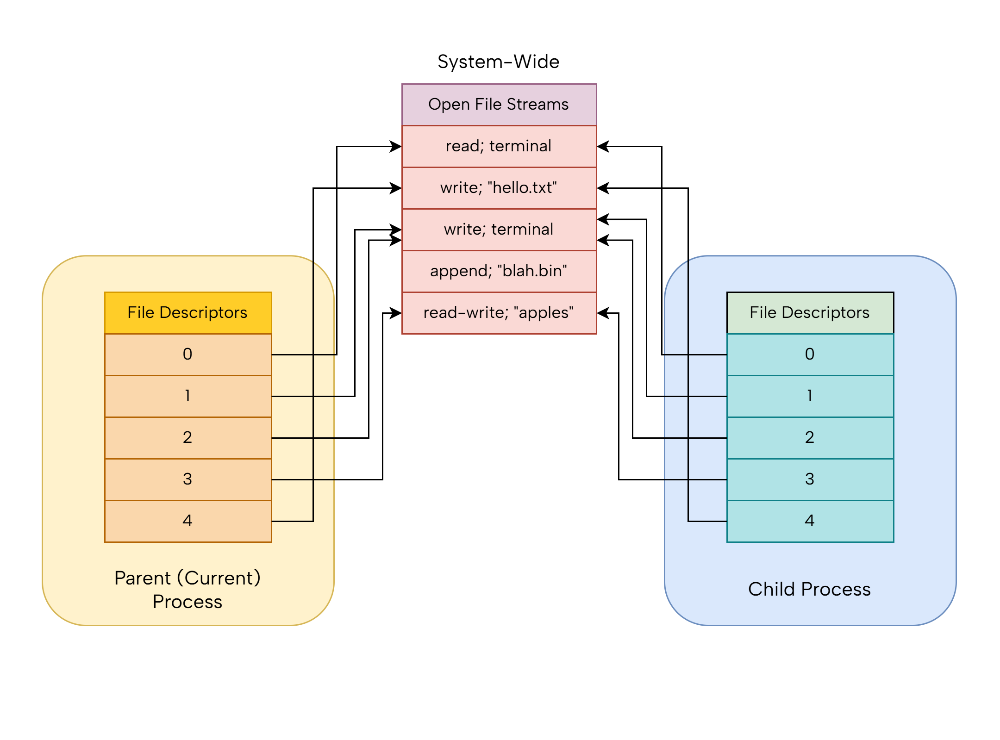
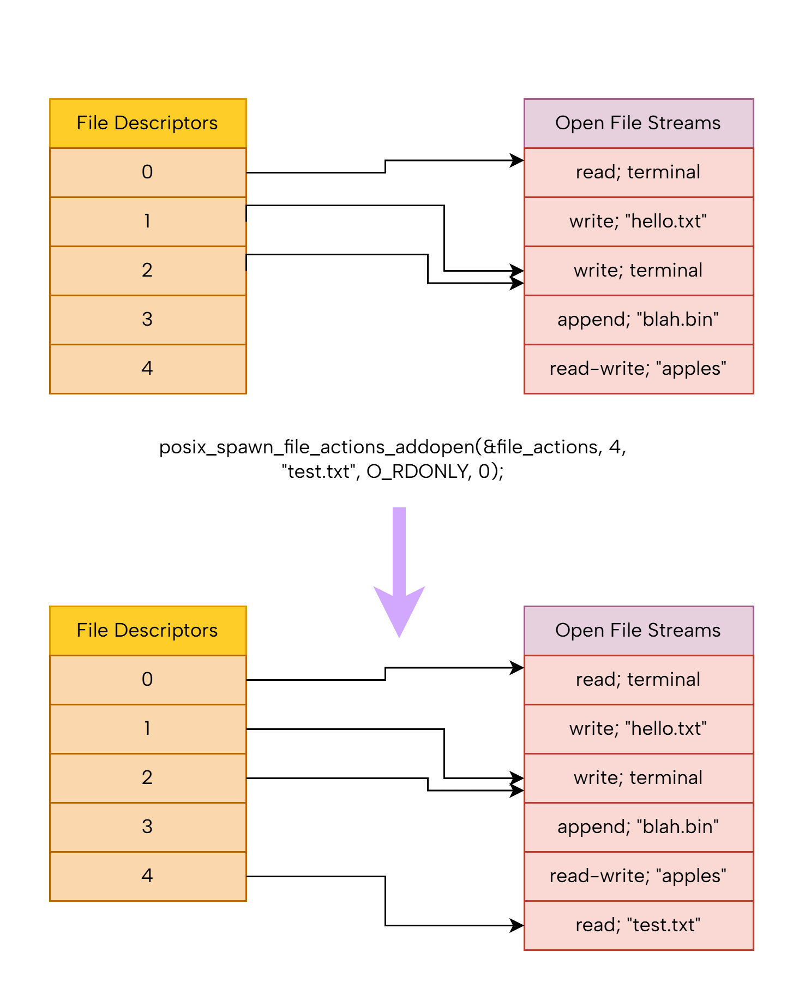
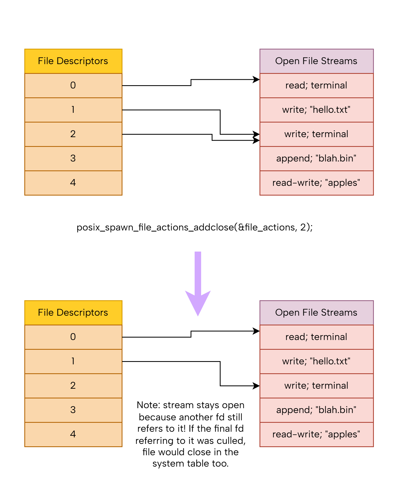
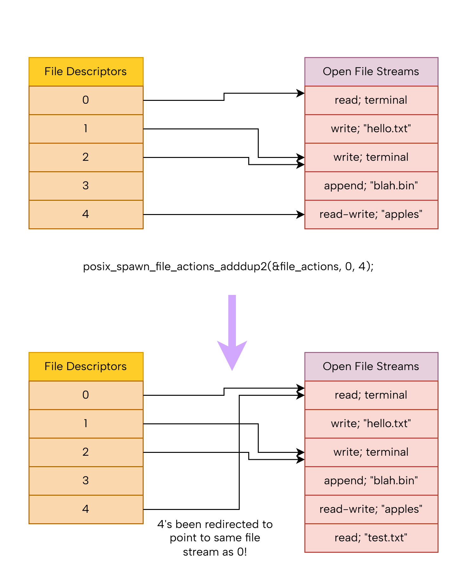
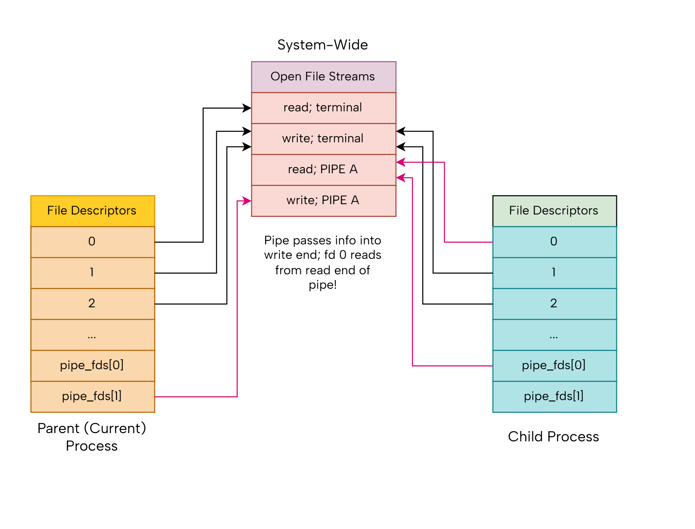

# Pipes - Summary
First of all, I hope everyone is having a good stuvac! There wasn't quite enough time to cover this in Week 10, at least not in the detail that I would want to, so here's an extra document hopefully helping to make pipes a bit easier to understand!

## File Actions
When we spawn a child process, the first step is forking (cloning) the current process, along with all process-specific data. One of these process-specific aspects is the file descriptor table for this file, showing what currently open file streams that process's file descriptors all refer to.

(The below diagram is a bit oversimplified, but for ease of illustration/thinking about it we can just ignore inode metadata for now, and say the system file info automatically contains some inode info/refer to files by name and not their inode number. It's also just after forking, so all the file descriptors still reference the same open files!)



While usually we do not need to modify the state of the file descriptor table between the child process being forked and it being transformed (using the `exec()` system call) to execute whatever program we want it to, if we want to, the `posix_spawn_file_actions` class of functions lets us do this. Basically, these functions allow us to set up a struct of file actions, add file actions to perform, and then destroy the file actions struct once we are done with it (a bit like `free` for `malloc`). Any file actions (things like closing files, opening files, and reassigning what file stream a file descriptor corresponds to) are performed on the child process's file descriptor table *after* the child is forked off the parent (current) process!

A code fragment to set up and then immediately destroy a file actions object is presented below.

```C
#include <spawn.h>
#include <stdio.h>
#include <stdlib.h>

int main(void) {
    // Initialise a file_actions object
    posix_spawn_file_actions_t file_actions;
    
    if (posix_spawn_file_actions_init(&file_actions) != 0) {
        fprintf(stderr, "posix_spawn_file_actions_init error\n");
        exit(EXIT_FAILURE);
    }

    // Nuke the object
    posix_spawn_file_actions_destroy(&file_actions);

    return 0;
}
```

### What File Actions Do We Have?
As mentioned above, file actions are just things like opening files, closing files, or reassigning a certain file descriptor to refer to a different file stream open in the system-wide file table. They're performed in the same order we add them. 

The three available functions are `posix_spawn_file_actions_addopen`, `posix_spawn_file_actions_addclose` and `posix_spawn_file_actions_adddup2`. `posix_spawn_file_actions_addopen` adds an `open` syscall to the list of file actions, opening a new file with the given file mode, specifying the file descriptor that file should be associated with. See `man 2 open` and `man 3 posix_spawn_file_actions_addclose` for more details; also, if you want to see what flag combos `fopen` modes correspond to, look at the man page for `fopen`. Likewise, `posix_spawn_file_actions_addclose` adds a `close` syscall to the list of file actions, closing the file associated with the given file descriptor. 

`posix_spawn_file_actions_adddup2` adds a `dup2` system call to the list of things to do. The `dup2` syscall can be a bit annoying to understand; basically, looking at the prototype, `int dup2(int oldfd, int newfd)`, a call to `dup2` guarantees that the file descriptor `newfd` is reassigned to refer to the same currently open file stream as `oldfd`.

  

  

  


A code example of how we can add file actions is presented below, without launching
the actual process.
```C
#include <spawn.h>
#include <stdio.h>
#include <stdlib.h>

int main(void) {
    // Initialise a file_actions object
    posix_spawn_file_actions_t file_actions;
    
    if (posix_spawn_file_actions_init(&file_actions) != 0) {
        fprintf(stderr, "posix_spawn_file_actions_init error\n");
        exit(EXIT_FAILURE);
    }

    // Open "test.txt" for reading and assign it the file descriptor number 
    // 9 in the child process. (Mode argument set to 0 as file isn't being
    // created, else would need to specify to the permissions the file has
    // if it is created!)
    posix_spawn_file_actions_addopen(&file_actions, 9, "test.txt",
        O_RDONLY, 0);

    // Reassign file descriptor 9 (currently referring to test.txt) to
    // refer to the same file as file descriptor 0 (terminal input). Any 
    // interactions that used either file descriptor 9 or a FILE * that 
    // contained file descriptor 9 inside, now interact with the terminal // input instead, in the child.
    posix_spawn_file_actions_adddup2(&file_actions, 0, 9);

    // Close the file associated with file descriptor 8 in the
    // child process.
    posix_spawn_file_actions_addclose(&file_actions, 8);

    // Nuke the object
    posix_spawn_file_actions_destroy(&file_actions);

    return 0;
}
```

Something to note - if we call `close` or `dup2` on a certain file descriptor, what it always does is stops that file descriptor from referring to that file anymore. However, it doesn't always close the file stream open in the system-wide file table! If there are any other processes that have file descriptors currently referring to the stream we just disconnected from, the actual stream in the system-wide table stays open. We'll be utilising this a lot with our pipes.

Throughout the course we've also mainly been working with `FILE *`, not file descriptors. How do we account for this? Well, we can use the function `fileno` to get the file descriptor associated with a `FILE *`, and we can use `fdopen` to set up a FILE struct for a given file descriptor, and let us use functions like `fopen` on something we initially opened as a file descriptor.

## How Do Pipes Work??
The entire idea behind pipes in Unix-based systems is to let processes communicate with each other speedily. One end works as a write end, one end works as a read end. Information that is written into the write end will be read sequentially from the read end. The system is treated as a pair of files, open together; each process with the pipe has either the write end open or the read end open, not both. Keeping both ends open will lead only to bugs and deadlocks, and one pipe is not enough for a process to both send and receive info from another process. You'd need to set up two pipes for that (or use an alternate way of communicating between two processes, e.g sockets, which aren't covered in the course)!

We use the special `pipe` function (documentation: `man 3 pipe`) to set up a pipe between a parent process and its child process. More details on using them are in the next section, but a brief code snippet featuring them are below!

```C
// A demonstration of how pipe files work within one process.
// Note how read gets anything we write into the write end!

#include <unistd.h>
#include <stdio.h>
#include <stdlib.h>

int main(void) {
    int pipe_1[2];

    // Sets up the pipe in the system-wide file table;
    // sets two file descriptors in this process to refer
    // to the read and write end; puts read end in pipe_1[0],
    // write end in pipe_1[1].
    pipe(pipe_1);

    // Using this you can now treat both ends as normal
    // using the stdio functions!
    FILE *read_end = fdopen(pipe_1[0], "r");    // read end is pipe_1[0]
    FILE *write_end = fdopen(pipe_1[1], "w");   // write end is pipe_1[1] 

    // Anything we write in the write end we get back in the read end.
    fputs("hello from the other side", write_end);
    fputs("... i must have called a thousand times...\n", write_end);

    // Let's close the pipe - if the write end stays open,
    // we never get EOF, so things go sideways.
    fclose(write_end);
    
    // We're expecting the same stuff as was in the pipe to
    // come through now! (note - only going to read until a new 
    // line char/EOF)
    char *pipe_output = malloc(sizeof(char) * 128);
    fgets(pipe_output, 128, read_end);

    printf("Message received from write end of pipe: %s", pipe_output);

    fclose(read_end);

    return 0;
}
```

## Writing Code With Pipes, Sanely
Pipes can be rather annoying to keep track of. If you are working with them, what I find works best for me is making a simplified sketch of the current file descriptor table + what open file streams in the system-wide file table they refer to. You will have working paper provided in the final exam; if pipes do rock up as one of the final few questions, I *strongly* recommend that you use it to sketch out how you're going to need to set everything up.

1. Any files that you need **shared between the two different processes** need to be opened and set up in the main code of our parent (the program that'll come from code we're writing, usually) process, **before** the `posix_spawn` call.
    - NOTE - *this includes setting up the pipe*, but NOT closing either of the ends! If we close the write end in our code, for example, before we call `posix_spawn`, then neither the current process nor the child process will have an open write end. 

2. Any file actions that we need to perform **only on the child process**, must be added to a **file actions object** using the above functions!
    - If we want to redirect file descriptor 1, aka stdout (usually corresponds to terminal output), to refer to the same file as file descriptor 5, ONLY in the child process, this would happen here.
    - E.g closing the read end of a pipe in the child process if we want to only write to it.

3. Any file actions that we need to perform **only on the current process** must occur **after** the `posix_spawn` call!
    - E.g closing the write end of a pipe that we're only going to be reading from on our end.

Let's walk through a pipes setup task together. I want to write a program that redirects the child process's stdin and instead take input from the parent process. We're going to need a pipe for this, but how do we go about planning how to approach this? Let's set up a diagram of what we want the file descriptor tables of both processes to look like in the end.



If I break this down into what steps I think about needing to happen to get here in
both the parent and child process, child process only, and parent process only, I get the following list of actions.

| Both | Child Only | Parent Only |
|------|------------|-------------|
| Set up pipe | Redirect stdin (file descriptor 0) to pipe read end | Close the unused read end |
|   | Close the unused write end |    |

Now that we've split up what needs to get done per category, we can use our checklist of when file actions need to happen in our program to set everything up! (Note: I'm ignoring a lot of error handling to simplify the code a bit, and avoid 20 thousand if statements. Please actually include those in your code though!)

```C
#include <stdio.h>
#include <unistd.h>
#include <spawn.h>
#include <sys/wait.h>

int main(void) {
    extern char **environ;

    // 1. Actions that need to occur in both the
    // parent and child process - making the pipe!

    int pipe_fds[2];
    pipe(pipe_fds);

    // 2. Actions that need to occur in only the child process - 
    // redirection of stdin and closing the unused write end of the pipe.
    posix_spawn_file_actions_t file_actions;
    posix_spawn_file_actions_init(&file_actions);

    // close write end of pipe in child
    posix_spawn_file_actions_addclose(&file_actions, pipe_fds[1]);  

    // redirect stdin's file descriptor to refer to
    // the pipe's read end instead
    posix_spawn_file_actions_adddup2(&file_actions, pipe_fds[0], 
        fileno(stdin));

    // Actually spawn the process
    pid_t child_id;
    char *child_args[] = {"./print_from_stdin", NULL};
    posix_spawn(&child_id, "./print_from_stdin", &file_actions, NULL,
        child_args, environ);

    // 3. Actions that need to occur only in the parent process - 
    // closing the unused read end!
    close(pipe_fds[0]);

    // DO WHATEVER YOU WANT
    FILE *pipe_write = fdopen(pipe_fds[1], "w");
    fputs("hello from the pipe\n", pipe_write);

    // Terminating - close last open end of pipe here to send EOF signals
    // appropriately to the child process!
    fclose(pipe_write);                     // MUST USE fclose, not close, 
    waitpid(child_id, NULL, 0);             // to avoid errors!

    posix_spawn_file_actions_destroy(&file_actions);

    return 0;
}
```

Now, we can do whatever else we need to, using the pipe as a regular file!

Wait, wouldn't this run into issues with things like `stdin`, `stdout`? Well, those and `stderr` are just inbuilt FILE pointers that act as wrappers for the file descriptors 0, 1 and 2. If we change what open file the file descriptors refer to, we change what open file the inbuilt FILE pointers refer to, and everything works!

How do we send through EOF like this? When we are done with a pipe on the parent's end, we need to close whatever end is still open on our end. If it's the read end it often doesn't matter as much, but if the write end is open on our end then the child process will never stop trying to read in info and get deadlocked. Just close it, tear down the setup things (free anything malloced, destroy the file_actions struct), and congrats, you're done! NOTE: If you've opened a file descriptor into a `FILE *` with `fdopen`, please only use `stdio.h` functions to refer to it (e.g `fclose`) to avoid errors!

## Common Bugs
- Getting the order of file descriptors the wrong way around in `adddup2` - check the order!
- Forgetting `waitpid` at the end.
- Mix and matching `FILE *` and file-descriptor-using file functions. `stdio` functions add buffers to files (for example, writing in larger chunks), which can cause BAD errors if you mix and match both without accounting for what's in the buffer! Once you switch to `stdio` functions, please don't switch back to syscalls.
